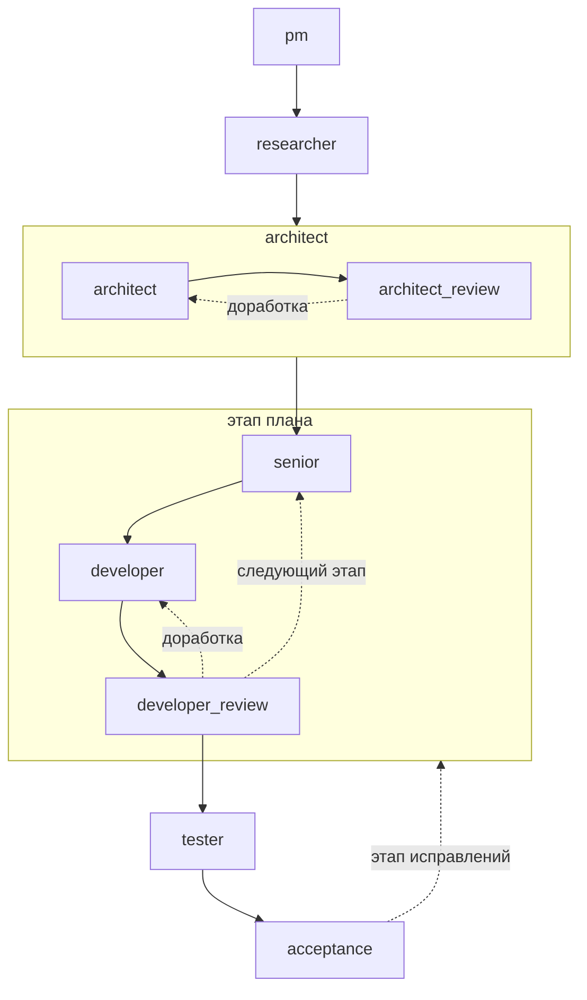
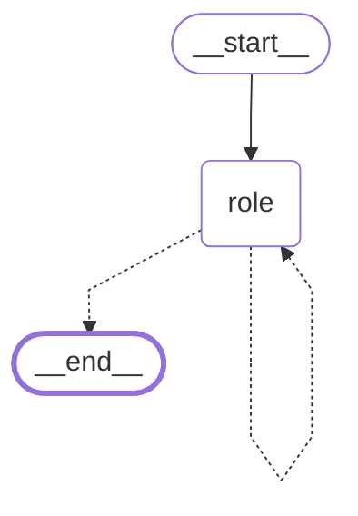
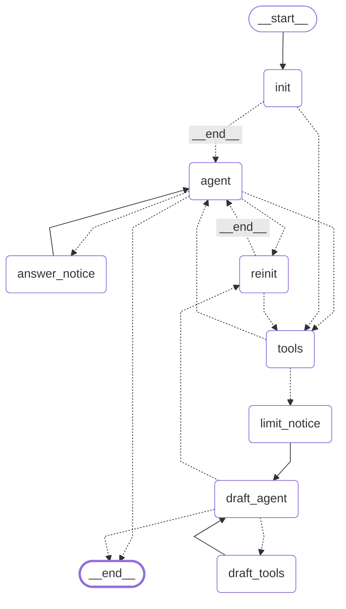
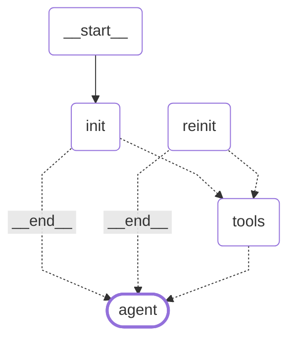
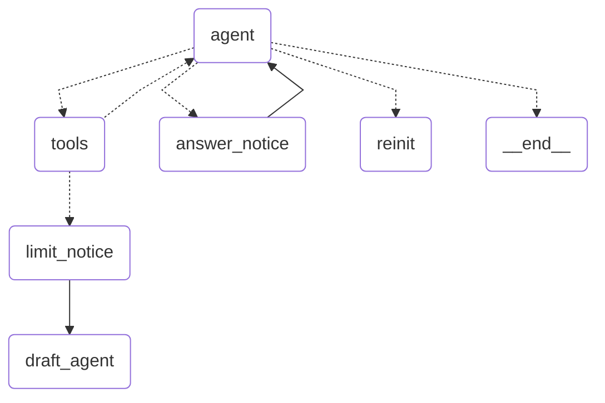
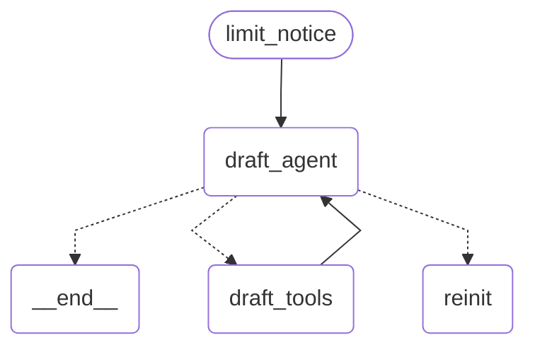

# Какие модели проверялись и в каких условиях

125k контекста
macOs 48gb объединенной памяти 
qwen3.5:9b (до 10 gb)
qwen3.6:35b-a3b-coding-nvfp4 (до 33gb)

# Как все устроено


Агенты выстроены в цепочку - делают свою часть работы и передают результаты следующему:

- `PM`
- `исследователь кода` 
- `архитектор`
- `ревью архитектора`
- `сеньор (планировщик этапа)`
- `кодер` 
- `ревьювер` 
- `тестировщик(и)`
- `приемщик`




- **[Проектный менеджер](../src/codeteam/core/roles/pm)** получает текст задачи, может читать дополнительные спецификации и картинки из папки docs проекта.

  Его цель: извлечь из задачи список требований (функциональные, не функциональные, ограничения и критерии готовности). Этот список служит чеклистом для всех последующих ролей.

  Инструменты: просмотр картинок (скриншотов из задания).

- **[Исследователь](../src/codeteam/core/roles/researcher)** Получает текст задачи и список требований. 

  Его цель провести исследование текущего кода проекта и описать верхнеуровнево - что есть сейчас в коде, что понадобится для решения задачи. Это исследование снимает нагрузку с архитектора.

- **[Архитектор](../src/codeteam/core/roles/architect)** на основе задачи, требований и исследования исследователя - пишет верхнеуровневую архитектуру решения. Разбивает задачу на этапы.

- **[Ревьювер архитектуры](../src/codeteam/core/roles/architect_review)** получает те же вводные что и архитектор.

  Его цель найти что упустил архитектор и вернуть на доработку в случае проблем.

- **[Сеньор](../src/codeteam/core/roles/senior)** берет из плана архитектора следующий невыполненный этап и пишет подробный план для разработчика.

  Инструменты: запрос в документацию Context7.

- **[Разработчик](../src/codeteam/core/roles/developer)** по плану сеньора реализует этап.

  Инструменты: запрос в документацию, проверить поведение в браузере.

- **[Ревьювер разработки](../src/codeteam/core/roles/developer_review)** получает план сеньора и смотрит код. 

  Его цель: проверить корректность реализации по коду и в случае проблем вернуть этап на доработку разработчику.

  Инструменты: проверить поведение в браузере.

- **Тестировщик(и)** одна роль или несколько, которые идут друг за другом: `tester` проверяет реализацию по коду, а `web_tester` и `web_scenarios_tester` проверяют поведение приложения в браузере. [(1)](../src/codeteam/core/roles/tester) [(2)](../src/codeteam/core/roles/web_tester) [(3)](../src/codeteam/core/roles/web_scenarios) [(4)](../src/codeteam/core/roles/web_scenarios_tester)

  Их цель: проверить итоговое решение комплексно после реализации всех этапов плана архитектора.

  По результату просто сохраняют свой вердикт и описание найденных проблем в состояние графа.

  Инструменты: проверить поведение в браузере.

- **[Приемщик](../src/codeteam/core/roles/acceptance)** смотрит на отчеты тестировщиков и принимает решение о готовности продукта.

  Его цель: принять решение о необходимости еще одного этапа доработки либо вынести вердикт о готовности.


Помеченные инструменты у каждой роли - не все, а только специфические которые были выданы дополнительно только им.


## Реализация пайплайна на Langgraph

Схема графа пайплайна разработки такая:


Всего один узел - `role` - запускает универсального агента (отдельный граф) с инструкциями каждой роли.

Роли идут последовательно одна за другой из составленного списка имен. 

Когда агент роли закончил, код узла выбирает следующую роль по списку ролей команды: 
- если ревьюер вернул работу — ту роль, которой вернули, 
- иначе — следующую по списку. 

Пока следующая роль есть, граф снова идёт в этот же узел ([pipeline/graph.py](../src/codeteam/core/pipeline/graph.py)).

## Реализация узла агента на Langgraph

Агент - также построен на графе из узлов и переходов. Прежде чем показать сам граф обосную решение.

### Маленький контекст

Используем локальные LLM, а значит контекстное окно не очень большое.
Проводил тесты на:
- qwen3.5:9b (до 10 gb видео-памяти)
- qwen3.6:35b-a3b-coding-nvfp4 (до 33gb видео-памяти)

Размер контекстного окна взял 125k.

Проблема:
На длительной задаче по работе со многими файлами агент может не успеть закончить работу до исчерпания
окна контекста. Произойдет компактизация и агент забудет по большей части что сделал, куда двигался, 
какие решения принимал и почему.

Решение:
- должен быть механизм когда у агента есть какое-то состояние текущей работы, которое формируется и обновляется по мере прогресса. Агент всегда видит состояние и принимает решения относительно него.

Возможны разные варианты реализации. Я в итоге выбрал такое:
- агенту дается 60к контекста на то, чтобы успеть выполнить свою работу или часть ее.
- если он успевает выполнить свою работу то отвечает сообщением **DONE** и его работа заканчивается.
- если не успевает, то при выходе за лимит 60к контекста система дописывает в результат последнего 
  инструмента примерно такое сообщение (сокращено и пересказано): 
  
  *Ты не успел выполнить работу, исчерпан лимит сообщений. Заморозь ее для передачи другому агенту.*
  *Создай файлы черновика с описанием своего решения в текущем состоянии тут (твой недоделанный ответ)*
  *и в файле context.md напиши что сделано, где ты сейчас и что еще надо сделать.*
  *Перечисли файлы которые ты открывал и какие уже не нужны для дальнейшей работы*
  *Запиши свой опыт для следующего агента, который будет доделывать твою работу*
  ([полный текст](../src/codeteam/core/agent/prompts.py#L150))

- Агент должен уложится в оставшиеся лимиты и записать черновик ответа в файлы + файл текущего состояния `context.md`
- Агент либо успевает (99% случаев либо нет)
- Успел - история очищается, агент получает на вход свои черновики и продолжает работу.
- Не успел - то же самое, но придется работать с тем что было записано.

Отсюда схема работы:
- инициализация начального состояния (загрузка задания и всех необходимых файлов через эмуляцию инструмента `read`)
- цикл работы
- цикл записи состояния
- переинициализация состояния с черновиками работы
- и т.д. пока не доделает работу

60к почему так мало?

На самом деле чуть больше. 
- Если в момент достижения лимита система видит что агент уже перешел 
к написанию файлов ответа (закончил работу), то его не переводят в режим черновика и дают возможность
доработать до тех пор пока он работает с файлами ответа.
- Если он успевает это сделать до исчерпания лимита контекста в 90к - молодец.
- Не успевает - переводится в режим черновика насильно.
- У него еще остается лимит в (125к - 16к) = 109к на то, чтобы успеть записать состояние.
- Последние 16к контекста это вынужденная страховка от переполнения контекста большим запросом (запас). 

Получается что при окне 125к, у него есть 109к на все свои дела и только 60к на чтение файлов задания и выполнение работы.

Если расширить максимальный контекст выше 125к, то на столько же можно расширить и остальные лимиты.

Да, мало. Тут остается полагаться только на качество инструкции по записи своего состояния. У меня инструкции не очень эффективные - нужно улучшать, но работают.
Агенты могут проходить много циклов сброса истории сообщения, но не забывают что делали и так или иначе доделывают работу (если не упрутся в лимиты на количество сбросов истории = 10).

### Граф агента

Код графа: [agent/graph.py](../src/codeteam/core/agent/graph.py)



Страшно, очень страшно...

Но давайте посмотрим на него по кускам:



Первый старт (`init`) и `reinit` после сброса истории:
В этих узлах собирается системный промпт, текст роли, общие инструкции агента, а также инициируется "прогрев":
система за агента вызывает инструмент `read` для чтения файлов документации, которые ему точно понадобятся.

Граф агента: работа



Рабочий цикл агента:
- вызов инструментов,
- насильный переход в reinit (сброс истории), например, в случае 3 неудачных попыток сдать работу,
- `limit_notice` - узел который добавляет в историю сообщение о превышении лимита контекста и уводит его в режим черновика.

Граф агента: черновик



Похож на рабочий цикл:
- агент пишет в файлы промежуточные результаты работы и описывает контекст,
- инструменты редактирования кода тут отключены (bash выдает отказы, а песочница запрещает менять файлы проекта),
- переход в reinit (очистка истории) после написания черновиков,
- остановка, если превышены лимиты по количеству сбросов истории.

## Инструменты агентов

### Базовые

Для чтения файлов и написания кода достаточно:

- `read` чтение целого файла или конкретного блока по номерам строк,
- `write` запись целого файла,
- `edit` редактирование блока внутри файла.

Но для тестирования и выполнения команд надо:

- `bash` выполнение консольных команд.

Агент уже становится полноценным и через консольные команды уже может делать практически что угодно.

На практике выяснилось, что агенты очень любят `bash`, умеют писать сложные изощренные команды и любят им пользоваться. 
При наличии bash игнорируют другие инструменты (`read`, `write`, `edit`).


Бонусные для облегчения и экономии контекста:

- `grep`  поиск по содержимому файлов регулярным выражением: возвращает файлы и номера строк с совпадениями,
- `glob` поиск файлов по маске имени, например src/**/*.py

Выглядят полезными, но тестируемые llm их вызывали очень мало - можно считать что не пригодились.

### Расширенные

#### Для работы с процессами (хелперы)

- `start_service` запуск сервиса в фоне с ожиданием готовности (по порту или строке лога); если порт был занят процессом агента - команда его предварительно остановит,
- `stop_process` остановка своих фоновых процессов; конкретный либо все агентские.

Зачем понадобились, если есть bash?

`stop_process` по сути дублирует kill в bash. 
Удобства у него два: 
- без номера процесса он останавливает все свои фоновые процессы 
- и гасит процесс вместе со всем, что запущено той же командой.

`start_service`: он возвращает ответ агенту только убедившись что сервис стартовал и условие готовности сервиса сработало. А также сам убьет предыдущий агентский процесс если он все еще висел на указанном порту.

#### Инструменты с агентами 

Инструмент запускает отдельного агента-помощника со своей задачей и возвращает его ответ:

- [`check_in_browser`](../src/codeteam/core/roles/browser_checker) агент-помощник внутри инструмента с браузером (Playwright MCP) проходит сценарии в запущенном приложении и описывает, что видит на странице; есть у разработчика и приёмщика этапа; работает по описанию от вызывающего агента,
- [`query_library_docs`](../src/codeteam/core/roles/advisor) агент-советник ищет ответ в документации библиотек (context7 MCP) и отвечает со ссылками на источники; есть у сеньора и разработчика,
- [`describe_picture`](../src/codeteam/core/roles/picture_viewer) смотрящая модель описывает картинку: скриншот или макет интерфейса; это не агент, а один запрос к модели; есть у PM, веб-тестировщика и помощника с браузером.


## Что можно было, но не успел

- инструмент веб поиска (вставить не долго, но требует отладки)
- ревью PM - критично
- саб таски у агента оркестратора - сам агент ничего не делает, а формулирует задачу небольшого шага для сабагента

# Опыт, проблемы

## Write, Edit, Read 

Как агенты создают и редактируют файлы?

Чтобы записать текст в файл его надо сгенерировать.
Чем больше файл, тем больше вероятность ошибиться.
Сгенерированный текст для файла - остается в истории сообщений и ест контекстное окно.
В случае ошибки записи - надо сгенерировать его еще раз и еще занять контекст.

Агенту-кодеру или писателю документации надо часто редактировать файлы, иногда точечно, иногда переписывая блоки текста.
Для этого есть инструмент Edit но как агент определяет - какие строки на что заменить?
По номерам? Велика вероятность ошибки - не тот номер вписал и файл испорчен.
Классический Edit имеет 2 параметра `old_string` и `new_string`.
Т.е. обязан перед редактированием хотя бы раз прочитать файл и для замены текста точно воспроизвести заменяемый текст 
плюс новый текст.

Тут та же проблема, что ошибка стоит дорого (меньше чем у Write) - 2 сгенерированных блока текста после каждой 
операции остаются в истории сообщений.

## Агенты-хакеры

Llm в погоне за целью делают много опасных вещей:
- создают файлы вне проекта, 
- один раз папка проекта удалилась - я не понял как, 
- убивают процессы (убили мне терминал через который я смотрел лог прогона), 
- в браузере вместо тестирования используют js-скрипты пытаясь через них смотреть файлы проекта и редактировать их.

## Агенты хотят писать код

- У архитектора задача спроектировать решение, но он пытается писать код.
- То же самое делает планировщик этапа (сеньор).
- Тестировщик пытается исправить найденный баг сразу же.

Промпты не помогают.

Если сделать запрет редактирования на уровне системы, агенты тут же делают другое:
- Вместо того, чтобы написать план или отчет - пишут в файл плана/отчета код, который им не дали написать в проекте.

## Агенты не слушают промпты и забывают инструкции

Не слушают и забывают) 
Например, в каком формате давать ответ, что можно и надо делать и т.д.

## Зацикливания

Частое поведение: инструмент отказал агенту. Агент повторяет попытку несколько раз с немного разными параметрами,
а потом и вовсе начинает по циклу вызывать одну и ту же команду раз за разом пока не кончится контекст.

# Решения

## Edit - мягкие проверки

Современные агентские харнессы, чтобы уменьшить количество ошибок при редактировании 
инструментом Edit, либо смягчают условие сравнения `old_string` с текстом файла
(прощают мелкие ошибки в пробелах, отступах и т.д.),
либо строят чуть более сложную систему, когда агент может не генерировать `old_string`,
а указывать диапазон номеров строк кода - которые надо заменить.

Второй вариант звучит просто, но на практике сложный.

Я подсмотрел решение у опенсорсного OpenCode и взял его 9 уровневую систему проверки `old_string` ([edit_utils.py](../src/codeteam/core/tools/files/_internal/edit_utils.py)).
Текст ищется в файле способами от строгого к мягкому. Каждый следующий способ прощает модели ещё одну
типичную ошибку. Замена делается, когда текст нашёлся ровно в одном месте файла:
- текст совпал буква в букву;
- модель ошиблась пробелами в начале или конце строк;
- модель точно помнит первую и последнюю строку блока, а середину — примерно;
- модель поставила лишние или пропустила пробелы внутри строк;
- модель сдвинула весь блок: другой отступ;
- модель написала перенос строки или кавычку как `\n` или `\"`, а не сами символы;
- модель добавила лишние пустые строки в начале или в конце;
- первая и последняя строки блока совпадают, а середина — хотя бы наполовину;
- модель просит заменить текст во всех местах файла сразу (например, переименовать переменную).

Защита: если найденный кусок намного больше того, что указала модель, правка отклоняется — мягкий поиск
не должен заменить лишнее.

Результат: гораздо меньшее число ошибок редактирования.

## Ответ агента - несколько файлов вместо одного

Т.к. большой текст за раз сгенерировать без ошибок сложнее и сложнее редактировать большие файлы,
то агенты пишут свои отчеты разделами: 1 раздел - 1 небольшой файл.

## Декомпозиция задач

Чем меньше задача, тем быстрее и легче решит ее агент, не потеряет фокус работы и уложится в контекстное окно.

Очевидный вывод: декомпозируем задачи везде, где это возможно.

Пример с финальным тестировщиком:
- Сначала была только одна роль которая должна была проверить и код и что приложение работает в браузере, 
- Декомпозиция 1: `tester`, `web_tester`, `acceptance`. Три роли вместо одной.
  `tester` - проверяет только код и запуски в консоли,
  `web_tester` - проверяет что приложение корректно работает в браузере,
  `acceptance` - читает отчеты двух предыдущих и выносит вердикт.
- Декомпозиция 2: заменяем `web_tester` на писателя тестовых сценариев 
  + автопрогон их системой на инструменте `check_in_browser`
  + саммаризация результатов прогонов каждого сценария `web_scenarios_tester`

Внутри `check_in_browser` сидит агент который по описанию быстро проходит путь сценария в браузере и
отвечает: что работает, а что нет, какие есть проблемы.

## Песочница

Агент через `bash` может сделать на компьютере что угодно. Поэтому его команды запускаются в песочнице
средствами самой системы: на macOS — `sandbox-exec`, на Linux — Landlock ([common/shell/sandbox](../src/codeteam/common/shell/sandbox)).

Что запрещает песочница:
- писать файлы вне разрешённых папок: роль пишет только туда, куда ей положено, плюс временные папки системы.
  Разработчик и приёмщик этапа пишут в проект, тестировщики — в проект только командами (тестам нужно
  создавать свои файлы), остальные роли — только в свою личную папку;
- останавливать чужие процессы: `kill` работает только на то, что агент запустил сам.

Инструменты `read`, `write`, `edit` проверяют пути сами: закрытые файлы (`.env`, личные папки других агентов)
они не читают и не пишут.

## Информационные хуки и проверки корректности системой ([step_hooks.py](../src/codeteam/core/agent/step_hooks.py))

- Заведены хуки, которые срабатывают после получения результатов инструментов записи - завершившихся ошибкой.
Если целевой файл распознается по имени как один из файлов ответа: хук добавляет в текст ошибки подсказку,
куда надо класть такой файл.

- Когда архитектор или сеньор пытаются писать в план блоки кода - хуки определяют их в файлах отчета в момент записи
по ` ```block ``` и добавляют в ответ инструмента замечание, что в план нельзя писать код.
Агенты чаще исправляют свою ошибку и переписывают план.

- В фазе черновика агент пытается писать или запускать то, что уже нельзя, — подсказка, что сейчас разрешено.

- Ревьюер записал вердикт не в том формате — замечание сразу, а не при сдаче;

- Агент пытается сдать работу командой `bash` вместо ответа **DONE** — подсказка, как сдавать.

## Проверки системой при сдаче работы (агент ответил DONE):

- черновик ответа не пустой и в нём есть все обязательные файлы;
- у ревьюера файл вердикта есть и в первой строке ровно один вердикт;
- у приёмщика этапа и тестировщиков — в проекте не осталось их правок: запускать команды в проекте им можно,
  а менять код нельзя.

Если проверка не пройдена, работа не принимается: агент получает отказ с перечнем замечаний и продолжает.
После трёх отказов подряд работу доделывает новый агент со сброшенной историей.

## Детекция циклов 

Для борьбы с циклами считаем количество одинаковых запросов с одинаковым ответом подряд,
при детекции - сначала добавляем модели подсказки типа "Может надо рассмотреть другой вариант",
а потом насильно переводим модель в фазу черновика либо сброс истории ([repeat_check.py](../src/codeteam/core/agent/repeat_check.py))

## Хуки с активным действием

- **откат правок:** приёмщик этапа или тестировщик изменил файлы проекта под git — система возвращает их
  к последнему коммиту и говорит агенту: "правка откачена системой - не делай так".

## Прогрев агента

При старте агента как правило уже известен некоторый набор файлов, который он должен прочитать:
- посмотреть папку проекта,
- прочитать файлы задания,
- и т.д.

Сразу после формирования системного промпта и сообщения пользователя с задачей, система сама подставляет 
в историю вызовы инструмента `read` на всех таких файлах, чтобы не тратить на это ресурсы сервера и время работы llm.

## Повтор запроса

Если модель ответила без вызова инструмента и без DONE (просто подумала и ничего не сделала) — запрос повторяется,
  а если не помогло — повторяется с подсказкой. Проблема решается.

## Обратная связь

Агент работает лучше, когда видит результат своей работы, а не только код.

- **Логи приложения.** Попросил агентов в AGENTS.md вести лог приложения. На qwen3 9b это заметно помогло:
  агенты по логу сразу видели что пошло не так, а не гадали, 
  и приложение из пустышки с тестами «для галочки» начало по-настоящему работать.
- **Проверка в браузере (`check_in_browser`).** Разработчик спрашивает агента-помощника, работает ли экран после его правок,
  и получает описание того, что видно. Ошибки исправляются на первой итерации, а не копятся до финальной проверки.

## Все что можно сделать без агента - надо делать за него

Пример: не просим разработчика делать коммиты - обвязка сама делает коммит после каждого этапа разработки.

# Результаты

[Тут](RESULTS.md)