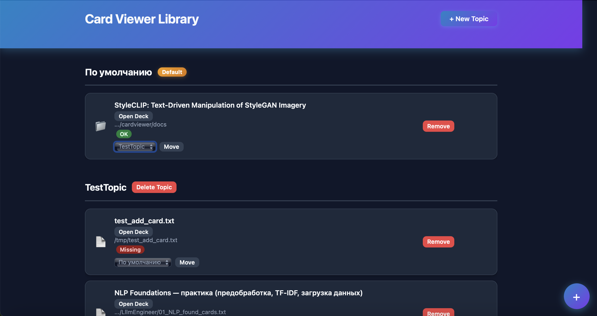
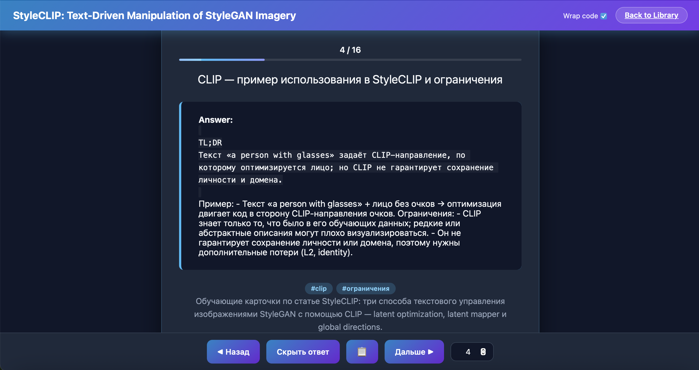

# Пример решения задачи

Реализовать локальное приложения: библиотека флеш-карточек для обучения.

<details>
<summary>Полный текст задания под спойлером</summary>

Нужно сделать локальное веб-приложение для просмотра обучающих карточек.

Карточки хранятся в текстовых файлах-колодах. Формат колоды описан в docs/card_pack_specs.md
Пример существующего набора карточек в docs/card_pack_example.txt


Что должно уметь приложение.

Библиотека колод:
- Пользователь добавляет в библиотеку источник: путь к файлу колоды (.txt) или к папке с колодами.
  Колоды из папки находятся автоматически.
- Источник можно удалить из библиотеки.
- Библиотека сохраняется между перезапусками приложения.
- Источники можно раскладывать по темам: пользователь создаёт тему, переносит в неё источник,
  удаляет тему. Есть тема по умолчанию, её удалить нельзя.
- На главной странице — темы, в них источники и их колоды. У колоды видно название из заголовка
  файла и раскрывающееся описание.
- Если файл или папка источника пропали с диска, это видно в библиотеке, приложение при этом
  не падает.

Просмотр колоды:
- Открываю колоду — вижу вопрос первой карточки.
- Стрелка вправо или пробел: если ответ скрыт — показать ответ, если показан — следующая карточка.
- Стрелка влево — предыдущая карточка.
- Кнопки «Назад», «Показать ответ», «Дальше» делают то же самое мышью.
- Виден номер карточки и их общее число, можно перейти к карточке по номеру.
- Блоки кода в ответе показываются как код, с сохранением отступов (markdown формат). Теги карточки видны.
- Кнопка копирования текста текущей карточки.
- Настройка «переносить длинные строки кода», запоминается в браузере.

Внешний вид:
- Хочу красочное, яркое приложение, которым удобно пользоваться и управлять наборами карточек.
- Нужен вау-эффект: красивые цвета, современный дизайн и прикольные анимации.

Ограничения:
- Приложение локальное, для одного пользователя.
- Открывать можно только колоды из источников библиотеки: произвольный путь с диска через адрес
  страницы не открывается.
- Язык — Python, веб — Flask, тесты — pytest.
- Адрес, порт и путь к файлу библиотеки задаются переменными окружения, у всех есть значения
  по умолчанию.

Целевая аудиотрия:
- обычный пользователь без технического образования, который хочет использовать карточки для изучения любого материала в простой, удобной и легкой манере.

Пример скринов приложения тут (как можно, но не по цвету а по смыслу):
docs/screens/main_lib.png
docs/screens/card_view_question.png
docs/screens/card_view_answer.png
docs/screens/card_view_finish.png

Готово, когда:
- приложение запускается одной командой, описанной в README.md;
- все сценарии выше работают из приложения;
- разбор формата колоды и работа библиотеки покрыты тестами, тесты проходят.

</details>

Скриншоты сделал с рабочего приложения, первую версию которого написал Claude Code
по весьма нечеткому ТЗ с примером карточек - которые надо парсить. У него ушло на первую версию минут 10.
Правда она не работала, но после пары правок завелась.
После этого было какое-то количество доработок - приблизительно можно оценить 30-60 мин с обратной связью от человека.

Чем ответят локальные модели?

# qwen3.5:9b

Первые тесты во время разработки проводил на модели qwen3.5:9b - были надежды что справится.

Само приложение и результаты этой модели не буду прикладывать, коротко:
- код написан;
- приложение запускается;
- тесты написаны;
- есть README.md - как запускать;

Но к сожалению не полностью рабочее:
- с главного экрана не перейти в просмотр карточек;
- есть косяки по интерфейсу.

Хотя в промежуточных версиях на протяжении разработки - я видел что экран просмотра карточек 
был, работал, были анимации, но с косяками по верстке.

Модель чинила один экран, после ревью получала замечания по другому экрану - чинила, но ломала первый.

Также по логам агентов во время разработки было видно что модель не может простейшие задачки,
например: распарсить на теги строку:
> #первый тег#второй тег  #третий
- выдумывала для этого странные костыльные подходы, хотя любой программист просто сделает
`split("#")` с последующим `trim(tag)`.

## Итог
- Что-то есть, но не работающее приложение
- Время работы 10-15 часов (последний был 15 - это как поезет)

# qwen3.6:35b-a3b-coding-nvfp4

Все гораздо лучше, меньшее количество возвратов на ревью, более качественный результат с первого раза.

## Итог
- Работающее приложение - быстро потыкал - все живое. Есть небольшие огрехи по верстке.
- Время работы: **11 ч 07 мин**
- Токенов на входе: **226 млн** (на выходе 1,9 млн)
- Количество запусков агентов: 140 (41 — роли конвейера, 99 — помощники)
- Количество вызовов инструментов: 8 885 (ошибок 2,9 %)
- Количество написанных файлов кода и вёрстки: 7 (3 py, 2 html, css, js), 93 KB
- Количество строк кода py: 990 (и 1 474 строки тестов)
- Количество тестов: 77, все проходят

## Время и токены по агентам

Больше всего времени:
- ревью кода — 3,3 ч (из них проверки в браузере — 1,1 ч);
- разработчик — 2,5 ч (из них проверки в браузере — 0,8 ч);
- проверка по сценариям в браузере — 2,2 ч;
- сеньор — 1,5 ч; тестировщик по коду — 1,3 ч;
- менеджер, исследователь и архитектура — 11 мин; приёмка — 2 мин.

Больше всего упирались в лимит контекста (после него — черновик и сброс истории):
ревьюер — 19 раз, разработчик — 13, тестировщик — 12, помощник проверки в браузере — 10, сеньор — 5.

## Выводы

Цифры получились большие и пугающие, но что поделать, таков эксперимент.

Кстати, прогон который был до этого, завершился за 5-6ч, что немного лучше, но там приложение было 
с несколькими визуальными косяками (тестировщики работали другие).

Надо сказать, что промпты у меня далеко не эффективные и с ними надо работать и улучшать. 
И мне кажется что я их немного подпортил во время последних попыток оптимизировать.  

Также есть место для оптимизации по составу пайплайна, гибкости и декомпозиции задач.

По времени я надеялся на 2-3 часа хотя бы и тогда с учетом оптимизаций и развития использование такого пайплайна
возможно и имело бы смысл.

**Как улучшить?**

- Промпты. Сейчас агенты делают много лишних кругов после сброса истории из-за того что начинают изучать код с 0,
а не пользуются информацией из сохраненного контекста
- Большее контекстное окно. `qwen3.6:35b-a3b-coding-nvfp4` позволяет использовать окно 256к.
  Дополнительные 100к контекста позволят агентам не терять фокус на задаче на более длинной траектории,
  исчезнут ложные круги, а возможно сбросы истории сократятся до минимума.

# Из интересного

- Документацию запрашивали 12 раз, в основном сеньор этапа 300 (9 запросов по Flask).
- «Посмотреть» в браузере при разработке и ревью вызывали 45 раз; описание скриншотов — 260 раз.
- Проверка по сценариям в браузере нашла ошибки, которые пропустили ревью и тесты по коду:
  не скрывался ответ, не было ошибки при неверном номере карточки, неверный статус пропавшего файла.
  По ним прошли два этапа исправлений (501 и 502).

## Скриншоты

Сам результат: [cardviewer](result_project_exmples/cardviewer)






# Примеры ответов агентов помощников

## [`check_in_browser`](../src/codeteam/core/roles/browser_checker) 

**Запрос**

> Проверка 2 - Hide answer button: На странице deck view нажать кнопку "Показать ответ". Убедиться что ответ появился и кнопка сменилась на "Скрыть ответ". Затем нажать "Скрыть ответ" — ответ должен исчезнуть, кнопка вернуться к "Показать ответ".
>
> Проверка 3 - Card counter layout: Проверить что счётчик карт (текст "1 / N") чётко расположен над полосой прогресса с правильным вертикальным отступом. Не перекрывает друг друга.
>
> Проверка 4 - Invalid jump input: Ввести в поле ввода номера карты значение 999 и нажать Enter. Проверить что: border поля стал красным, есть анимация shake, отображается сообщение "Card not found" под полем ввода.

**Ответ**

<details>
<summary>Ответ под спойлером</summary>

````markdown
# Observations for deck view tests

## Проверка 2 - Hide answer button

**Что делал:**
1. Открыл страницу по адресу `http://127.0.0.1:8050/deck/2456df7e-6c86-4910-a30b-4bb5fbb28da4`.
2. На стартовой странице кнопка имела текст "Показать answer". Ответ был виден на странице (элемент e17/e19 с strong "Answer:" и code блоком).
3. Нажал кнопку "Показать answer" (ref=e23).
4. После клика: ответ остался видимым, кнопка сменилась на "Скрыть answer" (ref=e40).
5. Нажал кнопку "Скрыть answer" (ref=e40).
6. После второго клика: ответ **остался видимым**, кнопка **продолжала показывать "Скрыть answer"** — не сменилась обратно на "Показать answer".

**Что увидел:**
- После первого клика "Показать answer": ответ появился (был виден с начала), кнопка изменилась на "Скрыть answer" ✅.
- После второго клика "Скрыть answer": ответ **не исчез**, кнопка **не вернулась** к "Показать answer" ❌.

**Ошибки консоли:** 1 error — `Failed to load resource: the server responded with a status of 404 (NOT FOUND) @ http://127.0.0.1:8050/favicon.ico` (не влияет на функциональность).

**Вывод по проверке 2:** Кнопка "Показать answer" меняет текст на "Скрыть answer", но кнопка "Скрыть answer" **не скрывает ответ и не возвращает текст кнопки обратно**. Функционал toggle не работает полностью.

---

## Проверка 3 - Card counter layout

**Что делал:**
1. Наблюдение за расположением счётчика карт "1 / 16" (ref=e55) и полосы прогресса на странице.
2. Сделал скриншот для анализа вёрстки.

**Что увидел:**
- Счётчик "1 / 16" расположен в верхней части карточки, над полосой прогресса.
- **По скриншоту (tmp_check/step3_card_counter.png):** Вертикальный отступ между текстом "1 / 16" и полосой прогресса минимальный — около 4-6 пикселей. Элементы не перекрывают друг друга, но расположены слишком близко для комфортного восприятия.
- **По скриншоту:** Текст "1 / 16" визуально смещён влево относительно центра прогресс-бара и ширины карточки — создаёт визуальный дисбаланс.
- Цвет текста серо-голубой, на тёмно-синем фоне читается нормально, но блеклый.

**Вывод по проверке 3:** Счётчик и прогресс-бар не перекрывают друг друга, но вертикальный отступ слишком мал (по скриншоту). Текст счётчика смещён влево относительно центра — дефект выравнивания.

---

## Проверка 4 - Invalid jump input

**Что делал:**
1. Ввёл значение "999" в поле ввода номера карты (spinbutton "Jump to card number", ref=e26).
2. Нажал Enter для отправки.
3. Проверил наличие красной рамки, анимации shake и сообщения "Card not found".

**Что увидел:**
- **Сообщение "Card not found":** Да, сообщение "Card not found (1-16)" отображается на странице (ref=e67 в snapshot). Однако на скриншотах оно не всегда попадает в область видимости viewport.
- **Красная рамка поля ввода:** По первому скриншоту (tmp_check/step4_invalid_jump_retry2.png) — поле с "999" имело толстую красную обводку и голубое свечение снаружи. По последнему скриншоту (tmp_check/step4_final.png) — красной рамки не видно, обычная тёмная обводка.
- **Анимация shake:** На статичных скриншотах анимация shake не видна (это динамический эффект). По первому скриншоту поле выглядело размытым по краям, что может указывать на наличие анимации. По последнему — чёткое изображение без признаков тряски.

**Ошибки консоли:** 1 error — `Failed to load resource: the server responded with a status of 404 (NOT FOUND) @ http://127.0.0.1:8050/favicon.ico` (не влияет на функциональность).

**Дополнительные наблюдения по вёрстке:**
- **По скриншоту (tmp_check/step4_final.png):** Блок основной карточки физически наехал на нижнюю панель навигации (footer). Текст "Глобальное направление..." частично перекрыт кнопками меню. Это дефект z-index / position у footer.
- На некоторых строках текст вылезает за правую границу блока.

**Вывод по проверке 4:** Сообщение "Card not found (1-16)" отображается ✅. Красная рамка на поле ввода наблюдалась при первом скриншоте, но не при втором — возможно анимация была кратковременной. Анимация shake не может быть подтверждена на статичном скриншоте.

---

## Общие замечания
- Console error `404 favicon.ico` присутствует на всех шагах — не критично.
- Footer (нижняя панель навигации) перекрывает контент карточки по скриншоту — дефект вёрстки.
- Toggle кнопки "Показать/Скрыть answer" работает только в одну сторону (показать → скрыть текст), но не обратно.

````

</details>

## [`query_library_docs`](../src/codeteam/core/roles/advisor) 

**Запрос**

> Flask 3: что вернёт request.get_json(force=True) когда body пустой или не является валидным JSON? Вернёт ли None или бросит исключение? Нужно понимать для обработки ошибок в API endpoint'ах.

**Ответ**

<details>
<summary>Ответ под спойлером</summary>

````markdown
# Flask 3: `request.get_json(force=True)` — поведение при пустом/невалидном JSON

## Что вернёт?

**Бросит исключение `BadRequest` (400), а не `None`.**

По умолчанию параметр `silent=False`. Это значит: при ошибке парсинга вызывается `on_json_loading_failed()`, которая в Flask 3 по умолчанию поднимает `BadRequest`.

## Поведение по параметрам

| Вызов | пустое тело / невалидный JSON |
|---|---|
| `request.get_json()` (по умолч.) | поднимает `BadRequest` (400), если парсинг не удался |
| `request.get_json(force=True)` | **то же самое** — парсит независимо от Content-Type, но при ошибке всё ещё бросает `BadRequest` |
| `request.get_json(silent=True)` | вернёт `None` (тихо обработает ошибку) |
| `request.get_json(force=True, silent=True)` | вернёт `None` даже если Content-Type не JSON и тело невалидно |

## Источники

- [Flask API docs — get_json](https://flask.palletsprojects.com/en/stable/api):  
  > `silent` (bool) — Silence parsing errors and return None instead.
- [Flask patterns/javascript — Receiving JSON in Views](https://github.com/pallets/flask/blob/main/docs/patterns/javascript.rst):  
  > "Raises a 400 Bad Request error if the payload is invalid JSON"
- [Flask source — on_json_loading_failed](https://github.com/pallets/flask/blob/main/src/flask/wrappers.py):  
  `BadRequest` поднимается по умолчанию; в debug-режиме показывается полный traceback, вне debug — просто 400 ответ.

## Пример для твоего endpoint'а

```python
@app.route("/api/topics/create", methods=["POST"])
def create_topic():
    # Вернёт None при пустом/невалидном теле (не бросит исключение)
    data = request.get_json(force=True, silent=True)
    if data is None:
        return {"error": "Invalid or empty JSON body"}, 400

    # ... обработка data
```

Или если ты хочешь стандартный 400 от Flask — просто используй `request.get_json()` или `request.get_json(force=True)` без `silent=True` и перехватывай `BadRequest`:

```python
from flask import request, jsonify
from werkzeug.exceptions import BadRequest

@app.route("/api/topics/create", methods=["POST"])
def create_topic():
    try:
        data = request.get_json(force=True)
    except BadRequest:
        return {"error": "Invalid JSON body"}, 400

    # ... обработка
```

## Ключевые моменты

- `force=True` **не отключает** обработку ошибок парсинга — только игнорирует Content-Type.
- Чтобы получить `None`, нужен **оба**: `silent=True`.
- Документация: [Flask API docs](https://flask.palletsprojects.com/en/stable/api).

````

</details>

## [`describe_picture`](../src/codeteam/core/roles/picture_viewer) 

**Запрос**

> проверить блоки кода оформлены как код с отступами, теги карточки видны под блоком ответа, нет наложения элементов, обрезанного текста, пустых областей

**Ответ**

<details>
<summary>Ответ под спойлером</summary>

````markdown
Привет! Я проанализировал скриншот экрана приложения "StyleCLIP" и подготовил описание для верстки.

### 1. Общая структура
На экране показан режим презентации или обучения (обучающие слайды).
**Сверху:** Шапка сайта с заголовком и кнопками.
**Центр:** Основная карточка со слайдом (на данном шаге ответ открыт/виден).
**Снизу:** Панель навигации между слайдами.

---

### 2. Детальное описание блоков

#### А. Шапка сайта (Top Navigation)
*   **Фон:** Горизонтальный градиент от насыщенного синего слева к фиолетовому справа.
*   **Слева:** Заголовок белым цветом, шрифт без засечек: `"StyleCLIP: Text-Driven Manipulation of StyleGAN Imagery"`. Текст крупный, жирный (Bold).
*   **Справа:** Два элемента управления в одну линию:
    1.  Текст `Wrap code` и рядом белый чекбокс. *Обрати внимание на проблему верстки ниже.*
    2.  Кнопка `"Back to Library"`. Фон кнопки светлый (белый/светло-серый), текст темный, кнопка имеет закругленные углы и тонкую обводку (border).

#### Б. Карточка слайда (Main Content Card)
*   **Фон карточки:** Темно-синий (`Dark Navy`), скругленные углы по всему периметру.
*   **Внутри карточки — Секция прогресса:**
    *   По центру: Цифры `"2 / 16"` (белый цвет, средний шрифт).
    *   Ниже: Линейный прогресс-бар (Progress Bar). Фон бара серый/темно-серый. Активная часть заполнена градиентом (синий -> фиолетовый), занимает небольшую долю от общего размера (примерно 15%, что соответствует цифре 2 из 16).
*   **Внутри карточки — Контент:**
    *   **Заголовок слайда:** `"Основные термины StyleCLIP"`. Белый цвет, крупный размер, выравнивание по центру.
    *   **Блок ответа (Answer Block):**
        *   Это прямоугольный блок темного цвета (почти черный) с левым отступом и ярко-голубой акцентной полосой (border-left) на левой стороне.
        *   Заголовок внутри блока: `"Answer:"`. Жирный шрифт, белый цвет.
        *   Список терминов ниже заголовка. Каждый термин выделен цветом (`#` или подобным), описание белым текстом. Текст разбит на строки через тире (`-`).
        *   **Шрифты внутри блока:** Используется моноширинный шрифт (как для кода/консоли).

#### В. Нижняя панель навигации (Footer)
*   **Расположение:** Прижата к низу карточки слайда, но визуально отделена от основного фона.
*   **Состав кнопок (справа налево или слева направо):**
    1.  Кнопка `"⬅ Назад"` (синий градиент, белый текст).
    2.  Кнопка `"Скрыть ответ"` (синий градиент, белый текст).
    3.  Иконка или кнопка-квадрат с иконкой внутри (визуально отличается от остальных, похожа на иконку "копировать" или "книга"). Фон такой же градиентный.
    4.  Кнопка `"Дальше ➡"` (синий градиент, белый текст).
    5.  Кнопка-цифра `"2"`. Выглядит как индикатор текущего слайда или поле ввода номера слайда. Темный фон, светлая обводка.

---

### 3. Аудит проблем (на что обратить внимание)

Внимательно проанализировав твои запросы и саму картинку, я выявил **серьезные дефекты верстки**, которые критично исправить перед релизом:

1.  **Критическое наложение элементов (Overlap):**
    *   **Проблема:** Блок с ответом (`Answer`) физически "налезает" на панель навигации снизу. Нижние кнопки (`Назад`, `Скрыть ответ` и др.) перекрывают нижнюю часть текста внутри карточки с ответом (последние 2-3 строки списка).
    *   **Риск:** Пользователь не может прочитать полный текст ответа, так как он скрыт панелью навигации.

2.  **Сломанный отступ/обрезание (Text Clipping):**
    *   **Проблема:** Из-за того, что контент внутри блока переполняет видимую область карточки и налезает на футер, текст "сплющен" или обрезан справа и снизу.
    *   В частности, видно, что строки списка `Answer` уходят в никуда под кнопками интерфейса.

3.  **Проблема с чекбоксом:**
    *   На верхней панели чекбокс элемента `"Wrap code"` выглядит отключенным или пустым, при этом он сильно выровнен по вертикали, но визуально может восприниматься как "битая верстка" из-за плохого контраста или отсутствия стилизации. (На скриншоте видно, что иконка внутри белая на светлом фоне, что делает её еле видимой).

**Итоговый совет разработчику:**
Сейчас интерфейс выглядит сломанным. Необходимо изменить CSS логику карточки: либо увеличить высоту карточки динамически в зависимости от содержимого списка, либо сделать блок ответа прокручиваемым (`overflow-y: auto`), чтобы скрыть лишнее и убрать наложение на панель "Назад/Дальше".
````

</details>

## `web_scenarios`

Пример сгенерированного сценария для проверки в браузере

**Запрос**

> # Show answer with button and ESC key (FR13)
> 1. На странице просмотра колоды нажать кнопку «Показать ответ» внизу экрана.
>    Должно быть: появился блок с текстом ответа; кнопка сменила текст на «Скрыть ответ»; в блоке ответа отступы кода сохранены; видны теги карточки в виде бейджей под ответом.
>
> 2. Нажать кнопку «Скрыть ответ» — убедиться, что ответ исчез и кнопка снова стала «Показать ответ».
>
> 3. Повторно показать ответ кнопкой. Затем нажать клавишу Escape на клавиатуре.
>    Должно быть: ответ скрылся; кнопка стала «Показать ответ».

**Ответ**

<details>
<summary>Ответ под спойлером</summary>

````markdown
# Observations for FR13: Show answer with button and ESC key

## Сценарий 1: Нажать кнопку «Показать ответ»

**Что делал:**
1. Открыл страницу приложения по адресу http://127.0.0.1:8050/
2. Нашёл колоду "StyleCLIP: Text-Driven Manipulation of StyleGAN Imagery" и открыл её кликом.
3. На странице просмотра карточки увидел кнопку «Показать ответ» в нижней панели (contentinfo).
4. Нажал на кнопку «Показать ответ».

**Что увидел после шага:**
- Появился блок с текстом ответа: виден элемент `code` с текстом "TL;DR StyleCLIP превращает..." и далее описание.
- Кнопка сменила текст на «Скрыть ответ» (элемент f6e116, f6e154).
- В блоке ответа отступы кода сохранены: код отображается в элементе `<code>` с моноширинным шрифтом.
- Теги карточки видны в виде бейджей под ответом: `#styleclip` и `#обзор`.

**Консоль:** 0 ошибок при клике по кнопке «Показать ответ».

**Вывод:** Сценарий 1 выполнен успешно — ответ появился, кнопка сменила текст на «Скрыть ответ», теги видны как бейджи.

---

## Сценарий 2: Нажать кнопку «Скрыть ответ»

**Что делал:**
1. После показа ответа нажал на кнопку «Скрыть ответ» (элемент f6e116, затем f6e154).
2. Повторно нажал на кнопку «Скрыть ответ» несколько раз (всего 3+ клика).

**Что увидел после шага:**
- **Проблема:** Ответ остался видимым, кнопка не сменила текст на «Показать ответ».
- После множественных кликов по кнопке «Скрыть ответ» ответ всё ещё виден в элементе `code`, а кнопка остаётся с текстом «Скрыть ответ».
- Консоль: 0 ошибок при кликах.

**Вывод:** Функциональность кнопки «Скрыть ответ» не работает должным образом — после кликов ответ не скрывается и текст кнопки не меняется на «Показать ответ».

---

## Сценарий 3: Повторно показать ответ кнопкой, затем нажать Escape

**Что делал:**
1. После сценария 2 (ответ виден, кнопка «Скрыть ответ») нажал клавишу Escape.
2. Проверил состояние страницы после нажатия ESC.

**Что увидел после шага:**
- Ответ **остался видимым** в элементе code (f6e175).
- Кнопка сменилась с «Скрыть ответ» на **«Показать ответ»** (f6e179).
- То есть ESC меняет состояние кнопки, но **не скрывает ответ**.

**Консоль:** 0 ошибок при нажатии Escape.

**Вывод:** Клавиша Escape изменяет состояние кнопки (с «Скрыть ответ» на «Показать ответ»), но не скрывает блок ответа. Ответ остаётся видимым даже после нажатия ESC.

---

# Итоговые наблюдения

1. **Сценарий 1 (Показать ответ):** Успешно выполнен. Ответ появился, кнопка сменила текст на «Скрыть ответ», теги видны как бейджи.
2. **Сценарий 2 (Скрыть ответ):** Не выполнен — после кликов по кнопке «Скрыть ответ» ответ не скрылся и текст кнопки не изменился. Кнопка не работает.
3. **Сценарий 3 (ESC для скрытия ответа):** Частично выполнен — ESC меняет состояние кнопки (с «Скрыть ответ» на «Показать ответ»), но **не скрывает ответ**. Ответ остаётся видимым.

**Общий вывод:** 
- Кнопка «Показать ответ» работает корректно.
- Кнопка «Скрыть ответ» не работает — ответ не скрывается и текст кнопки не меняется.
- Клавиша Escape изменяет состояние кнопки, но не скрывает ответ.

**Дефекты вёрстки (по скриншоту):**
- Блок ответа имеет левую вертикальную линию-акцент, которая обрывается резко, не доходя до нижнего скругления. По скриншоту — виден баг с border-radius.
- Цветной текст (зелёный в слове "optimization") налезает и заходит на белые строки сверху/снизу — проблема с padding или line-height в блоке кода.
- Текст внутри блока ответа обрезан по правому краю (видно окончания слов: "простра", "текст-изоб", "хорошо ра"), а не переносится на новую строку — ошибка логики text-wrap.
- Блок с текстом "сдвинут вверх", из-за чего его нижняя часть перекрывается нижней плавающей панелью управления — финальные элементы текста нечитаемы без скролла.
````

</details>